# Windows 任务拖拽预览 · 2026-10-23

以下为独立演示数据的程序内 HWND / GDI 绘制图。拖拽回归通过向应用列表发送鼠标、计时器和取消消息进行验证；这些图不是实际桌面截图。

[程序](../dist/GxTodo-Native-0.8.3.exe) · [修复与验收说明](windows-native.md)

## 跨象限：插入到任务前

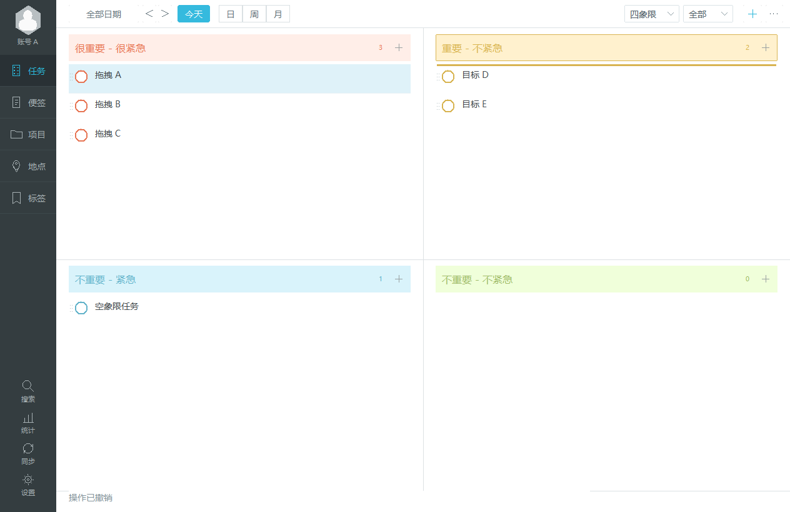

## 同象限：插入到末行后

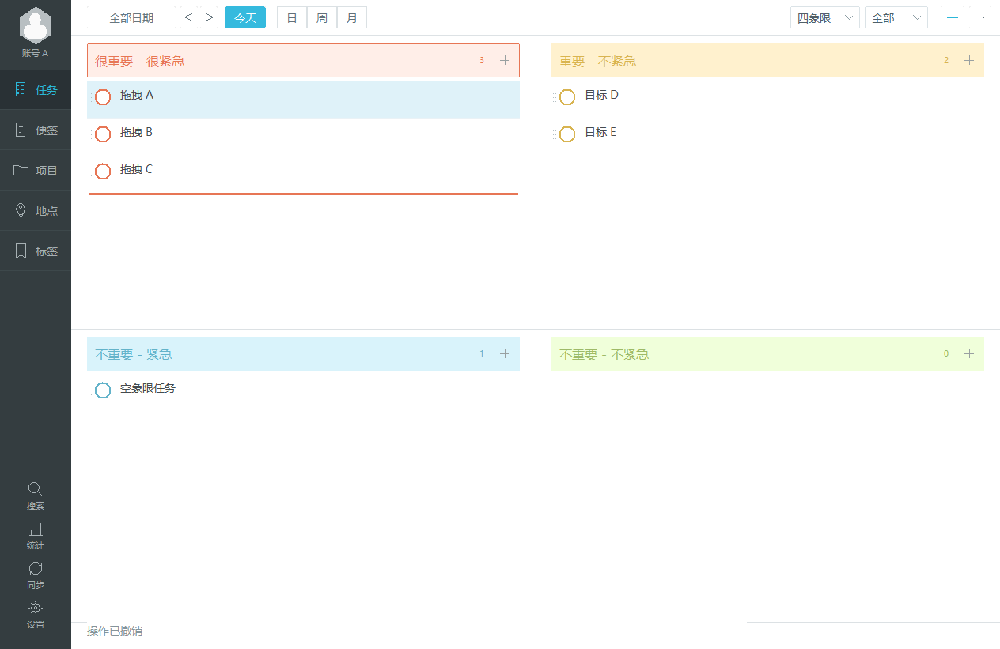

## 空象限落点

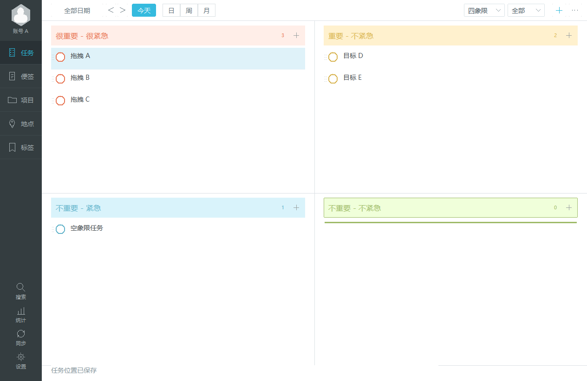

## 缩小象限落点

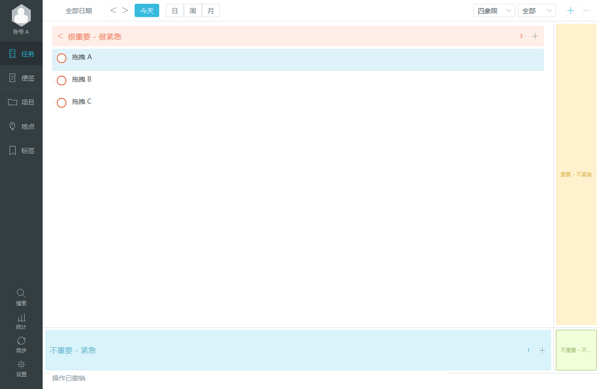

## Esc 取消后

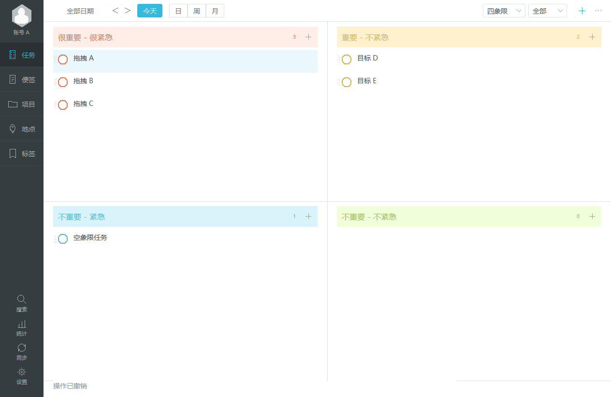

## 子任务排序

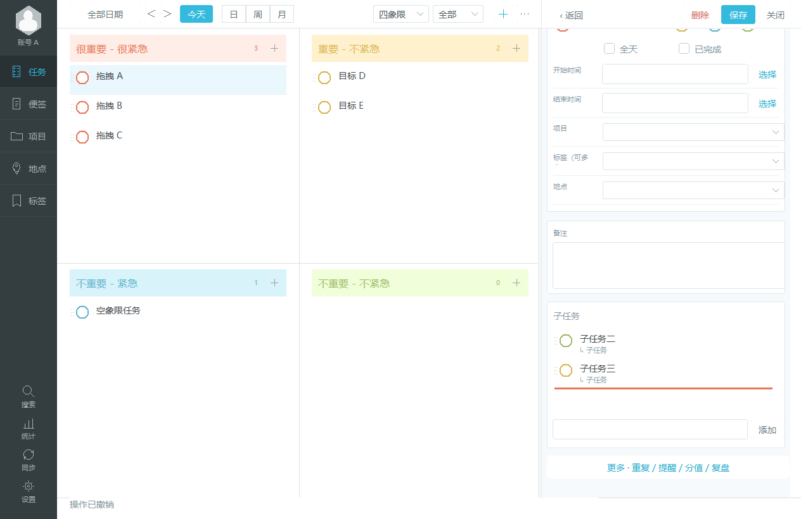

## 边缘自动滚动

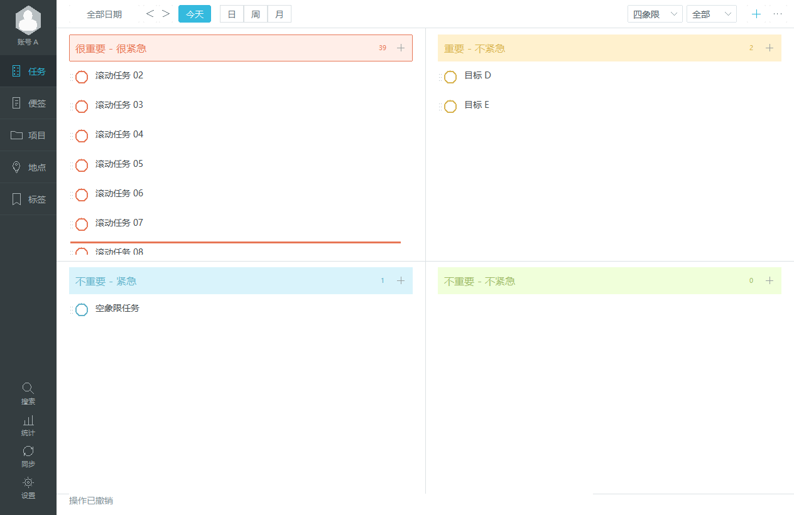

## 松手保存后

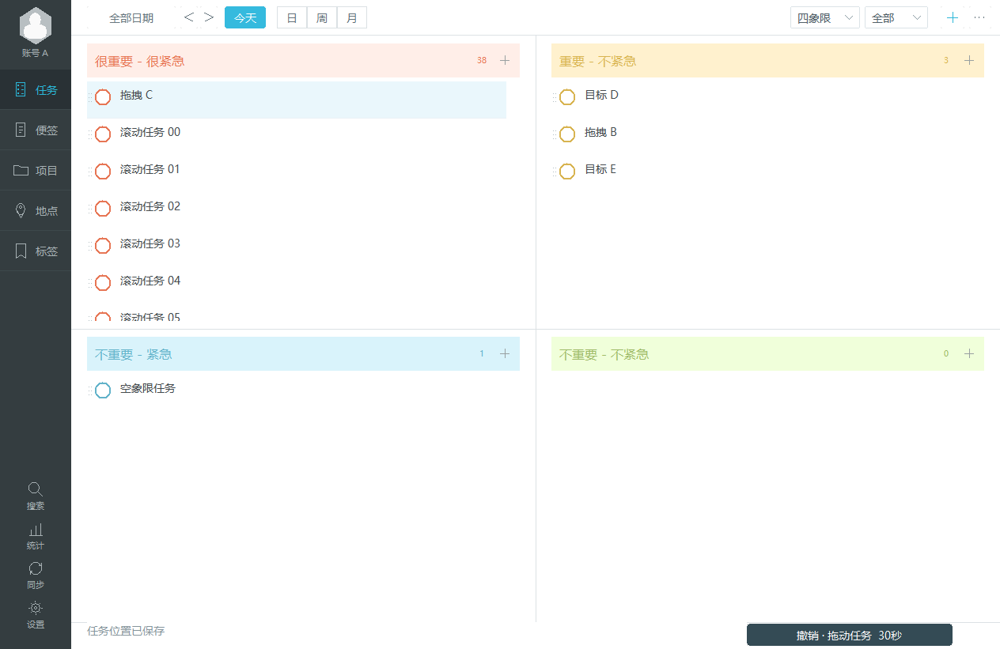

## 150%：跨象限

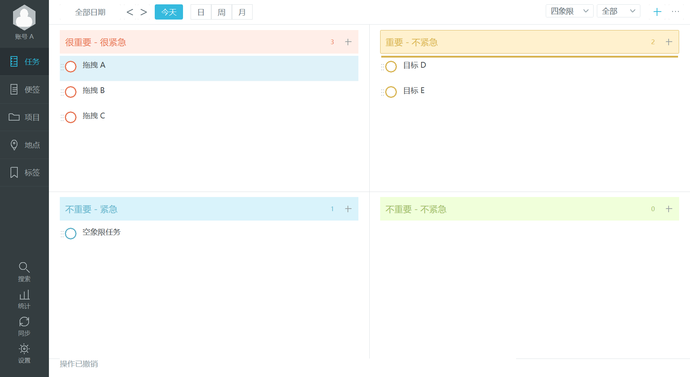

## 150%：子任务排序

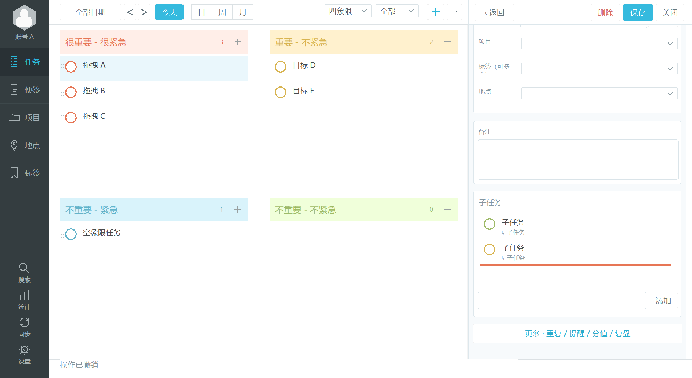

## 150%：缩小象限

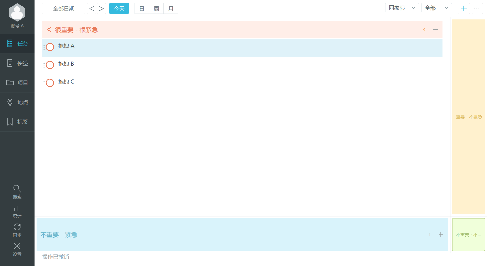

