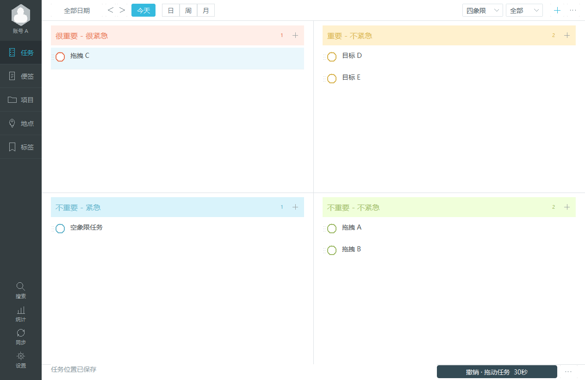
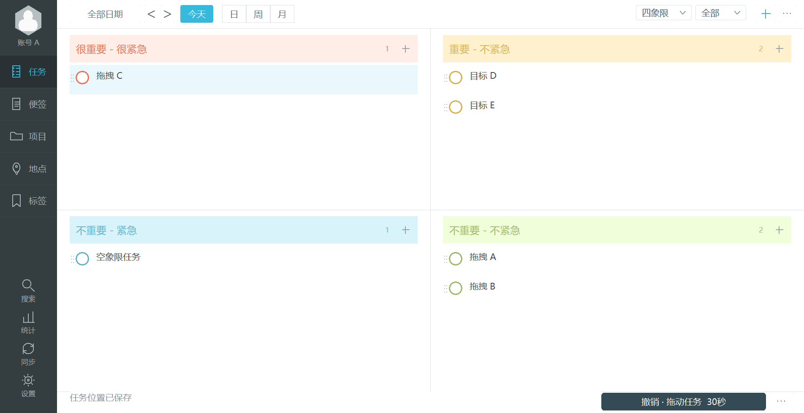

# Windows 原生版 · 数据库保存位置（2026-10-24）

当前使用版本为 [GxTodo-Native-0.8.3.exe](../dist/GxTodo-Native-0.8.3.exe)。下面保留各次修复的历史验收说明；其中提到的旧版 EXE、历史构建目录、源码快照和测试副本已于 2026-11-01 清理，现存业务数据及当前构建日志保留，详见 [清理记录](project-cleanup-20261101.md)。

设置现已支持查看、输入和选择数据库保存位置。选择本机空目录后点保存，会迁移全部本地账号及同步配置，成功后当前窗口立即使用新位置；原目录保留为备份。启动位置保存在 %LOCALAPPDATA%/GxTodoLocal/location.json。已保存目录不可用时会停止启动并提示，不会另建空数据。

[使用说明与设置预览](windows-storage-location.md)。原有标题新建、详情替换、手形拖动柄和卡片菜单均保留。全部测试在独立数据目录完成；当前用户的正式数据库尚未迁移。

发布文件：dist/GxTodo-Native.exe，1315328 字节。SHA-256：72aa22a2c6f8de3358c4c82cc3644babab5058c4d9f69d77a9bfc486e0cd6b4a。关闭旧窗口，重新打开桌面“高效 ToDo Windows 原生版”即可看到新设置。

最终版本通过核心 32 项、高级 48 项、100% / 150% 各 43 项保存位置检查、各 101 项拖拽与菜单检查、1,141 / 1,142 个重绘检查点及分类回归。六类布局过渡的中途不完整绘制次数均为 0。设置窗口预览来自 HWND / GDI，未进行真实桌面鼠标注入或本次云端联调。

以下保留此前版本的发布和验收记录。

# Windows 原生版 · 标题新建、详情替换与任务菜单（2026-10-24）

新版已发布至 dist/GxTodo-Native.exe（1,294,848 字节，约 1.23 MiB）。关闭旧窗口，重新启动桌面“高效 ToDo Windows 原生版”即可使用。SHA-256：27aca1278331127a4e32f19cceaa9ed945c453b4f6f17c132d051a70fb7a37a6。

## 当前交互

- 象限标题整条可新建对应优先级任务，包含标题文字、计数和“＋”。内容区空白单击与双击仍不会新建，客户区空白双击不会最小化。放大标题左侧的返回箭头仍用于恢复总览，缩小象限标题保留切换象限功能。
- 点击任务正文直接显示所选任务详情，窄窗口也不需要先放大象限。切换前自动保存当前有效修改，普通任务之间替换详情，不再累积关闭后重现的窗口。输入无效或保存失败时保留当前详情。
- “关闭”一次收起详情并清除其返回路径；父子任务仍可通过明确的返回按钮逐层查看。
- 鼠标悬停在任务或子任务最左侧拖动柄上显示手形，移到正文或离开列表恢复普通箭头。拖拽捕获、取消、边缘滚动和保存沿用已验收的处理。
- 任务三点菜单改为白色卡片，包含任务标题、编辑/完成、上移/下移、四色象限、当前象限勾选和红色删除按钮。已完成任务显示“重新打开任务”。关闭按钮、Esc 和点击背景遮罩都可收起菜单；删除仍需确认。右键任务和子任务三点菜单使用相同卡片。

[查看新菜单预览](windows-row-actions-preview.md)。

## 本次验收

96 / 144 DPI 各 101 项原生交互检查全部通过，覆盖标题新建、详情保存和替换、一次关闭、父子返回、手形鼠标、菜单真实按钮动作、撤销和删除确认取消。旧有多任务显示、移空残影、拖拽排序、捕获与取消检查也通过。每种缩放生成 17 张程序内绘制图。

96 / 144 DPI 的 1,144 / 1,145 个重绘检查点、32 项核心、48 项高级和页面回归全部通过。六类布局过渡的中间不完整布局绘制次数均为 0。菜单卡片使用真实 Win32 窗口和按钮验证，预览来自 HWND / GDI 绘制；本次没有进行真实桌面鼠标注入和截图。

同一万条合成任务数据库的 UI 对照中，上一版与本版完整刷新中位耗时分别为 53.898 / 52.567 ms（96 DPI），57.837 / 57.359 ms（144 DPI）。样本各 20 次，完整分位数与内存结果在构建记录中。本次未重测数据层、网页及真实云端联调。

正式数据未用于回归，原有程序进程未被强制关闭。源码备份、差异和日志位于 C:/Users/adwoo/Documents/ChatGPT/REA复刻项目/windows/build/task-menu-detail-20261024-1792807900707；旧版 EXE 备份为 C:/Users/adwoo/Documents/ChatGPT/REA复刻项目/dist/GxTodo-Native-before-menu-20261024-1792808708229.exe。[构建记录](../dist/windows-build.json)。

以下保留同日上一版和此前版本的记录。

## 同日上一版：拖动柄、图标和刷新优化

任务左端六点拖动柄已加宽，命中区域从 9 增至 14 个逻辑像素，约为原来的 1.5 倍。任务及子任务右端常驻三点按钮，点击打开编辑、完成、排序、移动象限和删除菜单。按住三点按钮不会启动长按拖拽，取消菜单会保留任务和父任务详情。

象限空白单击、双击都不会新建任务，客户区空白双击不会最小化窗口。该版本新建使用顶栏或象限标题右侧“＋”；本次已恢复象限标题整条新建。长标题会省略截断，开始时间与菜单各自保留显示空间。

图标沿用四象限配色，嵌入 EXE，同时用于窗口、任务栏和托盘。ICO 包含 16、20、24、32、40、48、64、96、128、256 像素十种尺寸，Windows Shell 已成功从最终 EXE 提取全部尺寸。桌面快捷方式的图标源为该 EXE。

[查看菜单、长标题和图标预览](windows-row-actions-preview.md)。程序内绘制图用于检查排版，真实桌面鼠标与跨显示器 DPI 切换沿用此前的验收边界。

## 5900X + GTX 1080 Ti 与性能实测

程序使用 Win32 / GDI 和 SQLite，主要界面工作运行在 UI 线程，WebDAV 同步使用独立工作线程。当前没有主动使用 Direct2D 或 Direct3D 加速，不能称为已充分发挥 1080 Ti；Windows 的最终桌面合成由系统处理。这类任务界面优先减少查询、布局和绘制开销，空闲时按需等待事件。

本次定位到象限计数会反复访问完整任务记录，新增包含父任务和状态字段的覆盖索引；同时跳过位置未变化的窗口移动和重复显示状态写入。悬停只重绘原行与新行。

在本机的一万条合成任务数据上测得：

| 操作 | 中位耗时 | 95 分位耗时 |
| --- | ---: | ---: |
| 四象限数据查询 | 1.794 ms | 2.064 ms |
| 关键词搜索 | 6.155 ms | 8.016 ms |
| 详情读取 | 0.045 ms | 0.052 ms |
| 同级任务排序 | 4.009 ms | 5.630 ms |
| 完整刷新与原生绘制，96 DPI | 49.462 ms | 57.739 ms |
| 完整刷新与原生绘制，144 DPI | 52.862 ms | 61.688 ms |

优化前，万条任务的完整刷新中位耗时为 115.989 ms；最终 96 DPI 耗时减少 57.36%。最终工作集约 22.98 MiB（96 DPI）和 27.38 MiB（144 DPI），私有内存约 6.3 MiB。42 条任务的完整刷新中位耗时约 45 ms，整窗刷新仍有固定开销。

数据层使用 40 次采样。界面测量先预热，再执行 20 次 ui_refresh、正常 WM_PAINT 处理与 GdiFlush，包含真实控件布局和原生绘制；最终 DWM 显示延迟不包含在计时内。此数据用于评估一次完整刷新，不能直接当作持续显示帧率。此前空闲 CPU 记录保留在历史构建元数据中，本次未重新采样空闲 CPU。

## 最终发布与验收

发布文件：dist/GxTodo-Native.exe，1,283,584 字节。SHA-256：f6f05ceff663d31f22b580dbc7b2348b34aa84e3bda26ab2d2fdd70e326d9bcb。

- 96 / 144 DPI 各 70 项原生交互与图标检查通过，含主任务/子任务菜单、空白点击、跨象限、合并与拆分、移空后残影、取消、撤销和数据库重开；每种缩放生成 13 张绘制图。
- 96 / 144 DPI 的 1,144 / 1,145 个重绘检查点全部通过。六类布局过渡的中间不完整布局绘制计数均为 0。
- 32 项核心、48 项高级及页面回归通过，全部使用独立测试数据库。本次没有重新执行网页和真实云端联调。

源码差异、备份、日志及校验值位于 C:/Users/adwoo/Documents/ChatGPT/REA复刻项目/windows/build/row-actions-icons-20261024-1792805274708。旧版 EXE 备份为 C:/Users/adwoo/Documents/ChatGPT/REA复刻项目/dist/GxTodo-Native-before-actions-20261024-1792806804195.exe。正式数据库未用于回归测试，已有旧程序进程未被强制关闭。[构建记录](../dist/windows-build.json) 包含完整测试与性能结果。

复测时使用独立目录：EXE --data-dir 测试目录 --drag-regression，或 --repaint-regression；可追加 --visual-dpi 144。性能入口为 EXE --data-dir 测试目录 --benchmark 10000，再执行 EXE --data-dir 测试目录 --ui-performance。benchmark 会创建任务，必须使用独立目录。界面性能入口只执行刷新和测量，不执行页面回归中的任务编辑。

以下保留此前各版本的修复与验收记录。

## 2026-10-23：任务移出残留与页面短暂白块

当前发布文件为 dist/GxTodo-Native.exe（1,123,328 字节，SHA-256：9f4e7cf8318cfb4f1e1288b8e86c3d2733cef860c349999cda3e230cb04fc2e1）。关闭当前旧窗口后，重新启动桌面快捷方式或 start-windows.cmd。

任务全部拖出后，原象限现在会立即绘制空列表背景。基线的任务数已为 0、正常绘制消息已处理完，仍有 110 个旧文字像素；修复版在 96 / 144 DPI 下均为 0。四象限列表和子任务列表使用同一背景清理方式。

页面切换、象限放大、窗口缩放、详情展开、滚动和窄窗口覆盖面板会先完成控件位置、文字与显示状态更新，再恢复绘制。更新期间保存目标显示状态，避免隐藏控件意外显示；详情滚动只更新对应面板。子任务列表还按实际行高和客户区宽度计算尺寸，避免 150% 缩放下末行和落点被滚动条挤住。

最终 EXE 的验收：

- 96 / 144 DPI 各 48 项拖拽检查通过，覆盖多任务合并、拆分、移空后无残留、子任务排序、取消、边缘滚动、撤销与数据库重开；各生成 11 张程序内绘制图。
- 96 / 144 DPI 的 1,144 / 1,145 个重绘检查点通过；六类布局过渡的原生绘制回调均使用完成后的布局，中途不完整布局绘制计数为 0。过渡验证前只处理正常 WM_PAINT，不额外强制重画来掩盖问题。
- 32 项核心、48 项高级测试和页面回归通过，测试目录均独立于正式数据库。

原始过渡探针在修复前捕捉到六类失败，日志为 probe-repaint.log。最终同条件旧版对照还触发了旧版访问异常，原始输出保存在 exact-baseline-repaint.log / exact-baseline-repaint-clean.log；此结果不计作最终修复版的测试通过数。原生鼠标消息回归窗口会在操作前恢复前台，防止其他窗口遮挡测试落点；真实鼠标注入、桌面截图和跨显示器 DPI 切换仍未完整验收。程序内绘制图仅作补充排版证据。网页、性能和云端联调沿用此前日期。

源码备份、差异、测试程序和日志位于 C:/Users/adwoo/Documents/ChatGPT/REA复刻项目/windows/build/repaint-transition-20261023-1792759044556。正式 EXE 的旧版备份为 C:/Users/adwoo/Documents/ChatGPT/REA复刻项目/dist/GxTodo-Native-before-transition-20261023-1792761831011.exe；[构建记录](../dist/windows-build.json) 包含校验值和全部日志名称。下方各节保留此前版本的修复与验收记录。

## 2026-10-23：同一象限多条任务只显示一条

已修复两条任务拖到同一象限后只看到一条、再拖出去才各自显示的问题。任务仍保存为独立记录；原生虚拟列表的绘制回调提供了空行坐标，旧代码把多行画到同一位置。这次每行都读取列表实际行边界，并把绘制限制在自己的行内。

上一版的程序内预览主动填写了行边界，未复现原生回调的空坐标问题。本次新增测试直接观察真实 NM_CUSTOMDRAW 回调完成后的各行标题像素，验证两条合并任务、重新拆分、子任务和后续拖放的每行都实际画出。相同回归修复前 47 项中有 5 项失败；修复后 100% 与 150% 缩放各 47 项均为零失败。32 项核心、48 项高级、页面回归及 870 / 853 个重绘检查点也通过。测试数据库均在 windows/build/ 下独立目录。

已更新 dist/GxTodo-Native.exe（1,119,232 字节）。旧版备份为 dist/GxTodo-Native-before-visibility-20261023.exe。关闭已打开的旧窗口，重新启动桌面快捷方式或 start-windows.cmd 即可使用新版。源代码、基线与修复版 EXE、日志及校验值在 C:/Users/adwoo/Documents/ChatGPT/REA复刻项目/windows/build/merged-visibility-20261023-1792756187463。

## 2026-10-23：任务拖拽修复

新版已发布到 dist/GxTodo-Native.exe（1,117,696 字节）。拖动任务最左侧的六点柄即可移动；也可在任务正文按住设置中的长按时间（默认 3 秒），再移动鼠标。轻点或双击拖动柄不修改任务，勾选圆圈仍只切换一次完成状态。

松手到行的上半部分会插入该行前，下半部分会插入该行后。支持跨象限、空象限、缩小象限和末行后落点；插入线和象限提示使用一致颜色。鼠标停在列表上下边缘时会自动滚动。Esc、丢失鼠标捕获、窗口失去激活、刷新或改变布局会取消拖动并清除提示。

子任务只能在同一父任务的列表中排序，保留自己的优先级。关闭再打开详情时，共享行高资源也会保留，避免任务行显示位置与鼠标命中位置错位。拖放保存象限和顺序，可通过撤销恢复；放回原位不会生成无效修改。

本次最终 EXE 的验证结果：

- 100% 与 150% 缩放下各 40 项拖拽检查，均为零失败。覆盖捕获、长按、轻点和双击、上下半行、跨象限、空象限、缩小象限、取消、子任务、边缘滚动、撤销、重新打开数据库后的保存，以及关闭详情后行高资源的保留。
- 32 项核心测试、48 项高级测试和页面回归通过；100% 的 870 个重绘检查点与 150% 的 853 个检查点均为零失败。
- 两种缩放下各 8 张拖拽过程绘制图生成成功，并查看了关键落点、子任务和滚动图。修复前源码接入同一测试后在首次鼠标按下处阻塞，7 秒超时退出；修复版能完成全部检查。

测试使用 windows/build/ 下独立数据库，通过发送 Win32 鼠标、计时器、按键和取消消息验证真实列表事件处理。Computer Use 实际窗口截图在本次两次尝试中仍分别报 FrameArrived timed out 和 window capture timed out。真实鼠标注入、触摸和跨显示器 DPI 切换未完整验收；程序内绘制图不等同于桌面截图。云端联调、万条任务性能及 91 项网页项目测试沿用此前记录，本次未复测。

[查看拖拽预览](windows-drag-preview.md) · [构建记录](../dist/windows-build.json)。旧版备份为 dist/GxTodo-Native-before-drag-20261023.exe。关闭当前旧窗口，重新启动桌面快捷方式或 start-windows.cmd 即可使用新版。

复测必须使用全新独立测试目录：EXE --data-dir 测试目录 --drag-regression；可追加 --visual-dpi 144，或 --drag-render 绘制输出目录。未提供 --data-dir 会拒绝运行。源码 windows/drag-test.c 已加入构建脚本。日志、修复前源码、基线程序和源码校验值保存在 C:/Users/adwoo/Documents/ChatGPT/REA复刻项目/windows/build/drag-20261023-1792745863846。

## 2026-10-23：点击后空白的重绘修复

已修复点击操作后顶栏、任务区或详情大片变白，鼠标移过去才恢复的问题。根窗口绘制背景时没有裁剪子窗口区域，会覆盖已绘制的控件；这次为根窗口、顶栏、侧栏和详情容器补齐子窗口裁剪，避免重复背景擦除，便签和分类卡片的位图输出也遵守同一裁剪。

已发布到 dist/GxTodo-Native.exe（1,102,336 字节）。当前打开的旧窗口需关闭后重新启动，桌面快捷方式和 start-windows.cmd 会使用新版。旧版备份为 dist/GxTodo-Native-before-repaint-20261023.exe。

验证结果来自本次发布的同一 EXE：32 项核心测试、48 项高级测试和页面回归通过；96 DPI 的 873 个重绘检查点、144 DPI（150%）的 853 个检查点均为零失败。修复前的对应基线有 646 个失败点。检查数量随可见控件和窗口尺寸变化。测试覆盖正常绘制消息处理、父窗口不覆盖子控件、页面切换、详情优先级修改、展开、滚动、保存、关闭和窄窗口面板。全部测试使用 windows/build/ 下独立数据库。

程序内绘制图在 100% 和 150% 缩放下生成成功，并查看了顶栏、详情、便签和窄窗口详情。此结果是 HWND / GDI 绘制验收；本次未取得实际桌面截图或实际鼠标交互验收。此前截图工具超时的限制仍保留。性能与 91 项项目测试数据沿用 2026-10-22 的记录，本次没有重新测试云端同步。

[查看本次绘制预览](windows-repaint-preview.md) · [构建记录](../dist/windows-build.json)。原始日志、修复前 EXE 和源码备份位于 C:/Users/adwoo/Documents/ChatGPT/REA复刻项目/windows/build/repaint-20261023-1792685572723。新增 windows/repaint-test.c 已加入构建脚本；复测命令为 EXE --data-dir 独立测试目录 --repaint-regression，可追加 --visual-dpi 144。必须先向独立测试目录导入演示任务；未指定 --data-dir 时会拒绝运行。

## 2026-10-22 UI 更新

- 顶栏压至 45 像素；侧栏图标、日周月按钮、四色象限标题与细分隔线对齐网页 demo。
- 任务详情有象限底色标题、彩色优先级圆圈、现代勾选框、时间和分类卡片、备注卡片、子任务卡片；输入框显示边框和焦点状态。顶部返回、删除、保存、关闭固定，正文独立滚动。
- 高级设置可展开编辑，固定操作栏在窄窗口和滚动时仍可见；时间显示为易读的日期与时分，保存仍使用兼容的 ISO 格式。
- 便签使用输入区和内容卡片，保留换行；按钮或 Ctrl+Enter 保存，切换页面、账号或关闭时保存输入草稿。
- 项目、地点、标签使用自适应卡片网格，显示任务数、完成数和进度；点击查看分类任务，右上角菜单编辑、归档或删除。
- 按需绘制悬停、按下、选中、焦点、拖动插入提示、面板阴影和倒计时撤销入口。没有常驻动画定时器。

[查看全部预览](windows-ui-preview.md) · [构建记录](../dist/windows-build.json)

## 本次验证与边界

32 项核心测试、48 项高级回归、91 项项目测试通过。新便签保存、离开草稿保存、分类任务打开和返回的程序内回归通过。所有测试使用 windows/build/ 下独立数据，正式数据库未写入测试内容；本次没有重新执行真实云端联调。

已查看程序自身 HWND / GDI 绘制图：四象限、四种优先级任务详情、高级区域底部、便签、项目、地点、标签、搜索、统计、象限放大、窄窗口；同时查看 96 DPI 和 144 DPI（150%）绘制图。该入口重用应用的控件布局和绘制，并为原生文本/列表提供输出到位图的绘制路径，属于程序内排版检查。

Computer Use 可读取窗口控件，实际窗口截图仍报 FrameArrived/window capture timed out。实际鼠标、拖动、触摸、下拉弹层及跨显示器 DPI 切换未完整验收。程序内绘制图不能证明这些交互已全部达到网页 demo 的效果；日期选择器和菜单仍采用 Windows 原生弹层。

本次万条任务（40 次采样）的中位数：四象限查询 4.02 ms、关键词搜索 6.85 ms、详情读取 0.055 ms、排序 4.93 ms。测量为数据库及操作层，未包含完整屏幕绘制。空白独立数据库窗口的 10 秒空闲采样：工作集 17.4 MiB、私有内存约 3.7 MiB、CPU 时间增量为零、GDI 30 / USER 60 不变；与旧版正式数据副本指标的数据量不同，不能直接比较。

## 复测

使用全新独立目录，避免给正式数据运行 UI 回归：

- EXE --data-dir 测试目录 --self-test
- EXE --data-dir 测试目录 --advanced-test
- EXE --data-dir 测试目录 --ui-regression（写入演示便签）
- EXE --data-dir 测试目录 --visual-test 输出目录
- EXE --data-dir 测试目录 --visual-test 输出目录 --visual-dpi 144

新版源码包括 windows/catalog.c，构建脚本已包含该文件。备份 EXE 为 dist/GxTodo-Native-before-ui-20261022.exe；源码与本次测试证据目录为 C:/Users/adwoo/Documents/ChatGPT/REA复刻项目/windows/build/ui-polish-1792683108303。

旧版完整功能、数据与同步说明见 [2026-10-21 说明](windows-native-20261021.md)。
