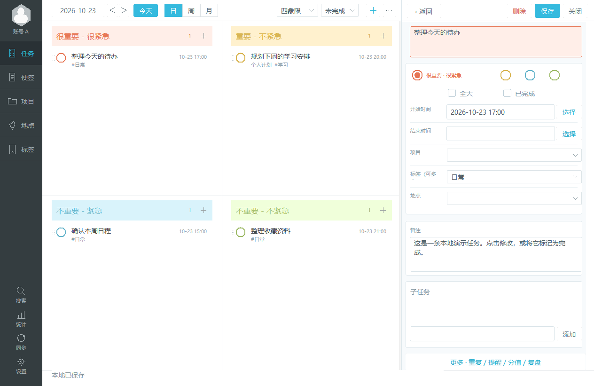
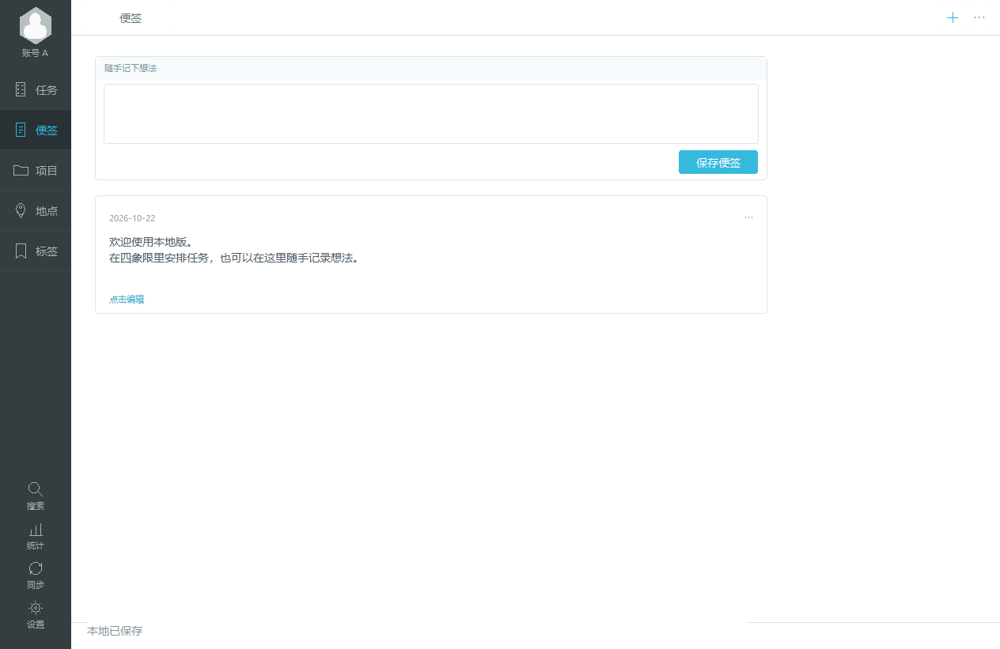
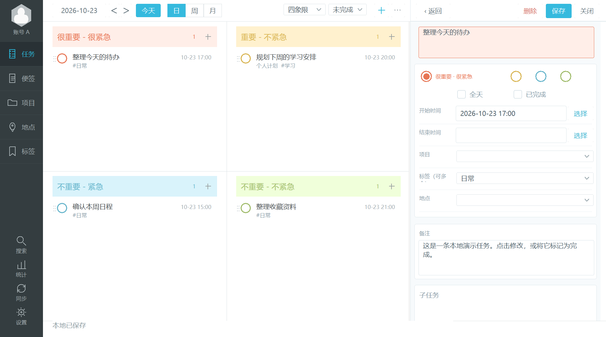

# Windows 重绘修复预览 · 2026-10-23

以下为独立演示数据生成的程序内绘制图。修复版：[GxTodo-Native-0.8.3.exe](../dist/GxTodo-Native-0.8.3.exe)；验证说明：[windows-native.md](windows-native.md)。

## 顶栏与任务详情

## 便签输入与保存

## 窄窗口任务详情

## 150% 缩放

