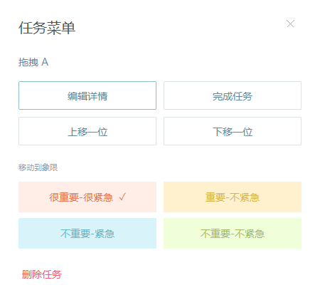

# Windows 任务菜单与详情交互预览（2026-10-24）

三点菜单使用白色卡片、四色移动按钮和当前象限勾选。任务标题随所选任务显示，已完成任务的按钮改为“重新打开任务”。

[150% 菜单预览](windows-menu-20261024/task-menu-card-144.png) · [已完成任务菜单](windows-menu-20261024/task-menu-completed-144.png)

象限标题整条可新建；内容区空白不新建。点击另一条任务会保存有效修改并替换详情，“关闭”一次收起详情。拖动柄悬停显示手形。

任务行的拖动柄、完成圆圈、标题、时间和三点按钮：

菜单和详情交互已通过原生事件回归。图片为程序自身的 HWND / GDI 绘制，[验收记录](windows-native.md)。
