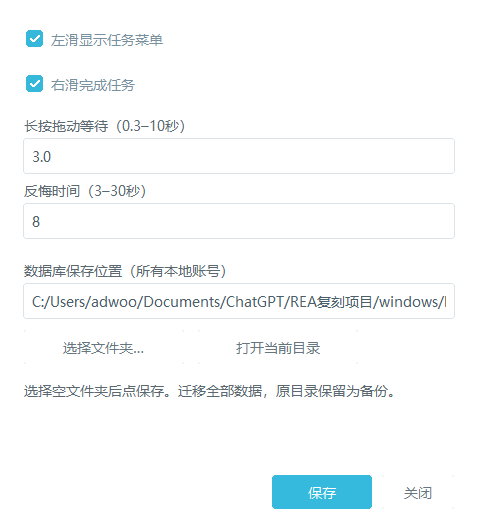
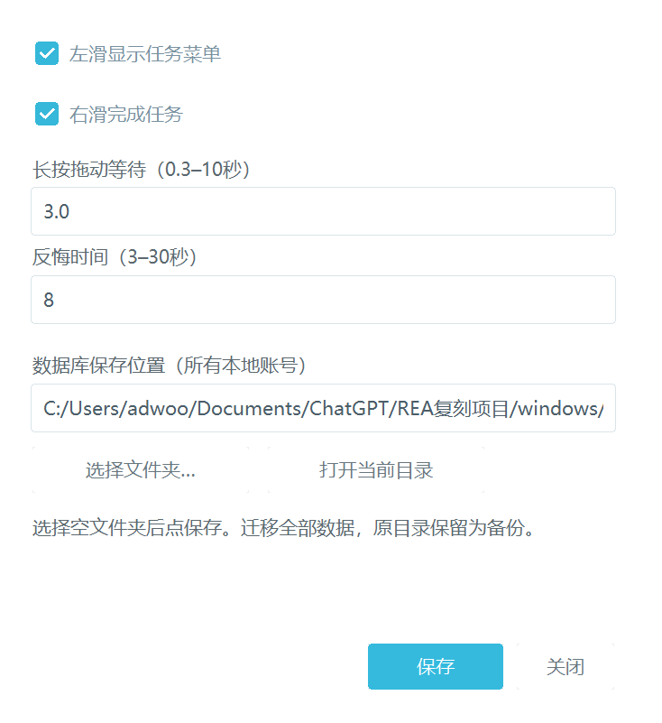

# Windows 数据库保存位置

打开左侧“设置”，在“数据库保存位置（所有本地账号）”中输入绝对路径，或点“选择文件夹…”选择本机磁盘上的空文件夹，再点“保存”。“打开当前目录”可在资源管理器中查看当前数据根目录。

保存时会迁移全部本地账号的 SQLite 数据库、同步配置、提醒记录、账号清单和旧备份；通过 SQLite 快照复制包括 WAL 中的已提交修改，并逐库核对完整性。成功后当前窗口立即使用新目录，继续编辑无需重启，原目录保留为备份。目录内已有文件时不会覆盖。同步正在运行或另一窗口仍使用原目录时会暂停迁移。

保存位置记录在 %LOCALAPPDATA%/GxTodoLocal/location.json。通常启动优先使用此设置；--data-dir 和 GXTODO_DATA_DIR 可显式覆盖，使用覆盖的窗口会显示说明并禁止在设置中迁移。没有保存位置设置时保留旧规则：存在 M:/dev/gxtodo-local/data/tasks.sqlite 就使用该目录，否则使用 %LOCALAPPDATA%/GxTodoLocal/data。已保存的目录不可用时会明确报错，避免另建空数据库。

数据根目录下的 tasks.sqlite 是账号 A；其他账号位于 accounts/账号ID/tasks.sqlite，accounts.json 记录账号清单和当前账号。坚果云凭据保存在各账号的 sync-config.enc，经 Windows DPAPI 加密；同一 Windows 用户在本机更改目录后仍可解密。

## 设置预览

以下图片来自独立测试数据的真实 HWND / GDI 绘制，包含测试目录路径。未对正式数据库执行迁移。

## 验收

100% / 150% 各 43 项位置设置检查通过，覆盖取消、多账号、子任务、删除历史、设备标识、待上传内容、同步进度、加密配置、提醒记录、迁移后编辑和读取，以及非空/包含关系目录、其他读者、同步中、损坏数据库、设置文件写入失败的回退。

最终候选的 32 项核心、48 项高级、两种缩放各 101 项菜单和拖拽、1,141 / 1,142 个重绘检查点、分类页面回归全部通过。GUI 回归按顺序运行，重绘测试使用可见窗口且先验证启动可见性。前一次启动器隐藏窗口的六项无回调结果已保留为诊断日志；未将其计为验收通过。

本次未执行真实桌面鼠标注入、跨显示器 DPI 切换或云端联调。正式数据未写入测试内容，正在运行的程序没有被强制关闭。
