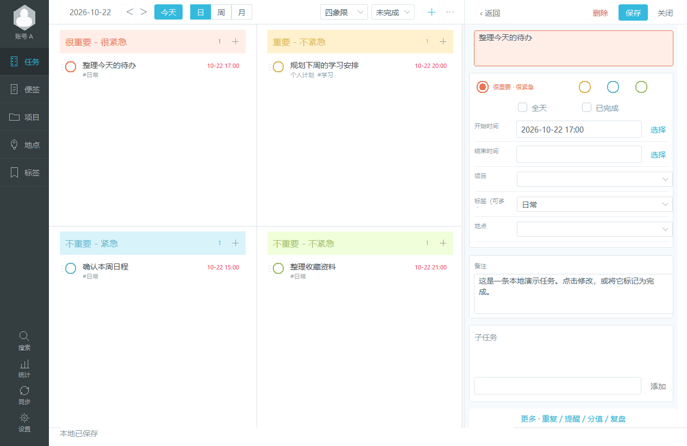
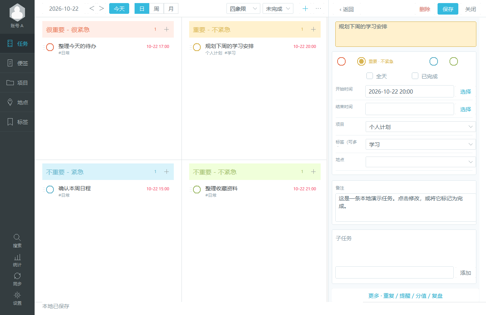
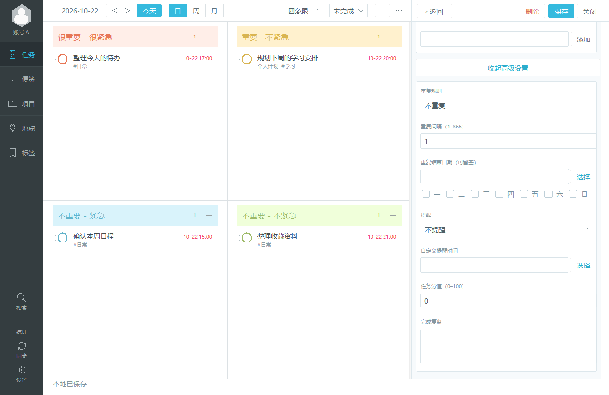
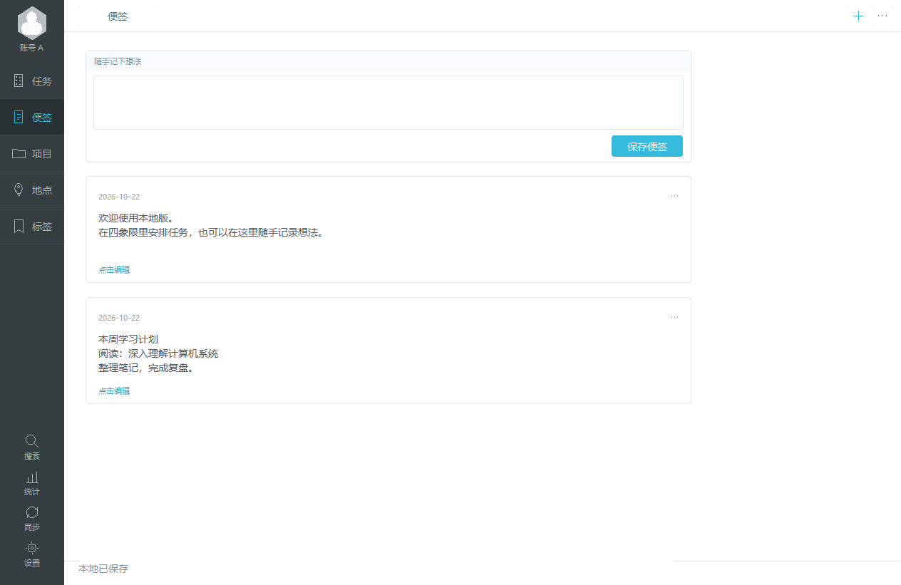
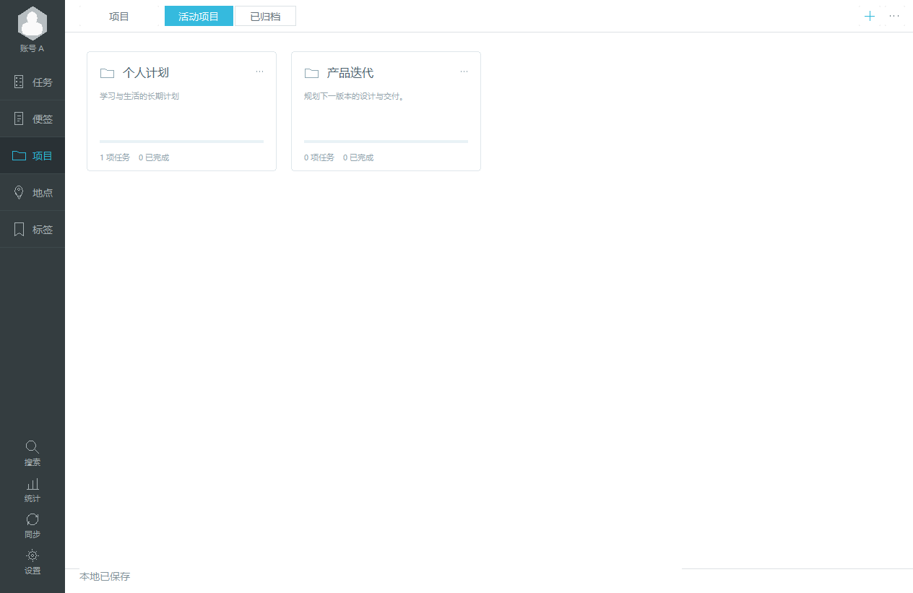
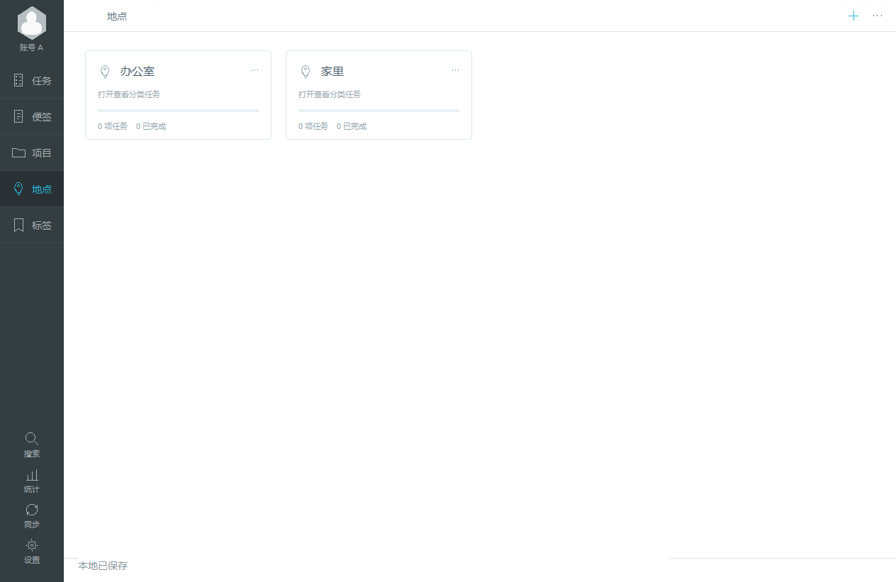
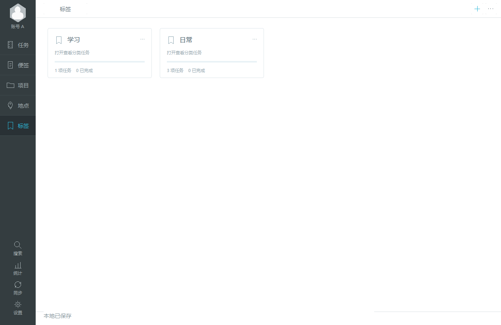
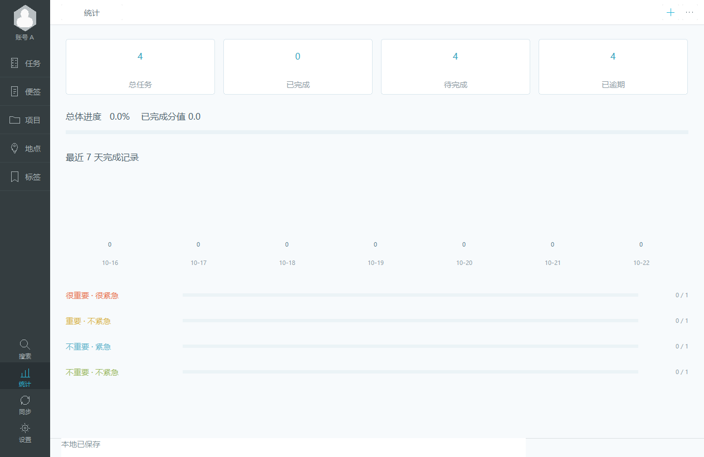
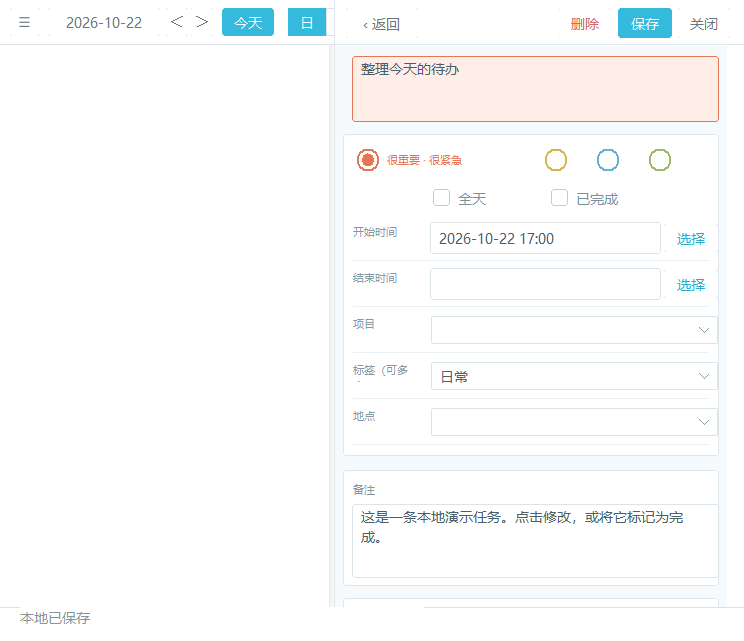
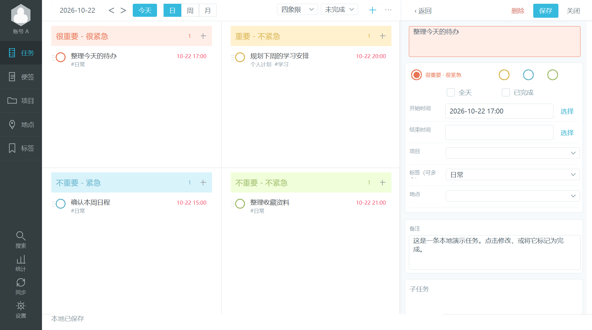

# Windows 原生版 UI 预览 · 2026-10-22

以下为独立演示数据的程序内绘制图，非桌面截图。新版程序为 [GxTodo-Native-0.8.3.exe](../dist/GxTodo-Native-0.8.3.exe)，验证范围见 [说明](windows-native.md)。

## 四象限与任务详情

## 重要、不紧急任务

## 高级设置滚动到底部

## 便签输入和内容卡片

## 项目卡片

## 地点卡片

## 标签卡片

## 统计

## 窄窗口详情

## 150% 缩放

